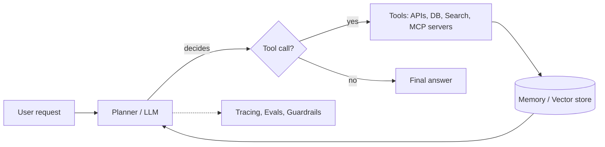

<h1 align="center">Hi 👋, I'm Tej Bhatt</h1>

  

  📍 Thane, Maharashtra, India &nbsp;·&nbsp;
  <a href="https://www.linkedin.com/in/tejbhatt20/">LinkedIn</a> &nbsp;·&nbsp;
  <a href="mailto:tejbhatt98@gmail.com">Email</a>

> I'm open to conversations about agentic AI engineering roles: remote (worldwide), or on-site/hybrid in Mumbai, Pune, Bengaluru, or Hyderabad. If my work looks like a fit for your team, I'd be glad to connect on [LinkedIn](https://www.linkedin.com/in/tejbhatt20/).

---

## 👨‍💻 About me

I'm an **agentic AI engineer** who designs LLM-powered systems that plan, call tools, remember context, and actually ship. My background is **full-stack engineering** (Node.js, React, Python, cloud), so I care about the unglamorous parts too: reliability, cost, latency, testing, and observability.

- 🔭 Building: **[Project name]**, [one line on what the agent does]
- 🏢 Working on: [mycirql.com](https://www.mycirql.com/index.html), [your role and the AI angle]
- 🌱 Learning: multi-agent orchestration, agent evals, prompt caching, agent security
- 💬 Ask me about: agent design, Node/Python backends, React, algo-trading, stoic philosophy

---

## 🧠 How my agents work

---

## ⭐ Project spotlight: [Project name]

**Problem:** [who has it and why it hurts]  
**Solution:** [agent design in 1–2 lines, tools used]  
**Results:** [metric 1] · [metric 2] · [metric 3]

[Live demo](link) · [Architecture notes](link) · [Source code](link)

---

## 🚀 Featured projects

| Project | What it does | Stack |
|---|---|---|
| 🤖 **[agent-project-1](link)** | [e.g. Research agent that searches the web, summarizes, and cites sources] | Python · LangGraph · Claude API |
| 🔌 **[mcp-server-project](link)** | [e.g. MCP server that exposes X to any LLM client] | TypeScript · MCP |
| 📚 **[rag-project](link)** | [e.g. Q&A over documents, with an eval suite showing accuracy] | Python · pgvector · FastAPI |
| 📈 **[trading-agent](link)** | [e.g. Market-news analysis agent with strict guardrails] | Python · Kafka · Redis |
| 🎨 **[TezUI](https://github.com/tejbhatt/TezUI)** | Frontend component library | TypeScript |

> ⭐ Each repo has a demo, architecture notes, and setup steps.

---

## 💼 Experience

- **[Role], [Company]** (20XX – Present): [what you built] → [measurable outcome]
- **[Role], [Company]** (20XX – 20XX): [what you built] → [measurable outcome]
- **[Role], [Company]** (20XX – 20XX): [what you built] → [measurable outcome]

---

## 🛠️ Tech stack

**AI & agents**

**Languages, backend, data and infra**

  

---

## 🔬 What I focus on

- **Tool use and orchestration:** planning, routing, retries, human-in-the-loop
- **Retrieval:** chunking, embeddings, hybrid search, re-ranking
- **Quality:** regression evals for prompts and agent behavior, tracing, cost tracking
- **Safety:** permission scoping, prompt-injection defenses, sandboxed tool execution

---

## 🎓 Certifications & courses

| Certification | Issuer | Year | Credential |
|---|---|---|---|
| ☁️ **AWS Certified AI Practitioner (AIF-C01)** | Amazon Web Services | [Year earned, or "in progress – exam [month]"] | [Verify on Credly](your-credly-link) |
| 🏅 **[Agentic AI / building agents course]** | [DeepLearning.AI / Anthropic Academy] | [Year] | [Verify](link) |
| 🏅 **[Hugging Face Agents Course]** | [Hugging Face] | [Year] | [Verify](link) |

> ✅ Every entry links to a verifiable credential.

---

## 📊 GitHub stats

  
  

---

  <i>"How long are you going to wait before you demand the best for yourself?"</i> — Epictetus

